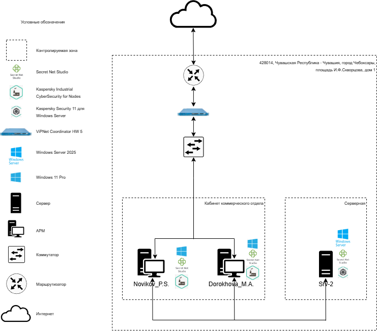
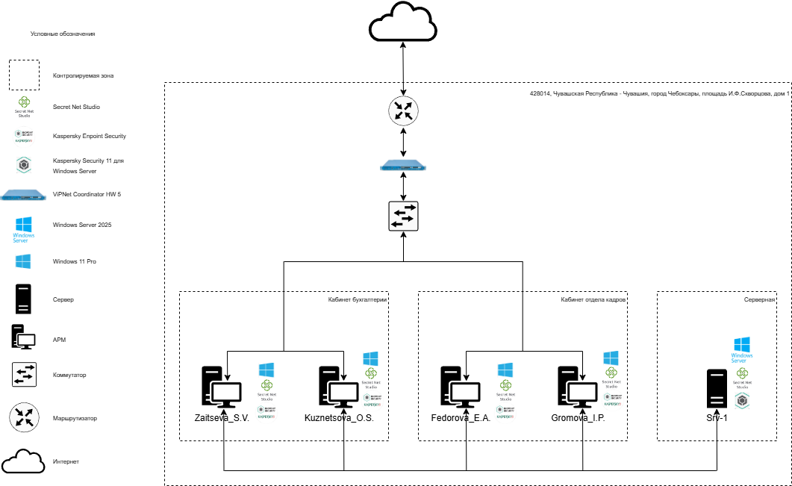

# Практическое задание №1. Проведение аудита безопасности ИСПДн аэропорта

## 1. Цель работы

Освоить методику проведения аудита безопасности информации в организации на примере аэропорта. Научиться собирать свидетельства, описывать информационные системы и потоки, формировать опросные листы, определять уровень защищённости персональных данных (УЗ ПДн) в соответствии с требованиями законодательства РФ и оформлять результаты аудита в виде итогового отчета.

## 2. Исходные данные

**Объект аудита:** Аэропорт (Чувашская Республика).
**Внешние взаимодействия:** Передача данных в государственные структуры (Росавиация, МВД, ФНС и т.д.). Обмен данными с аэропортом Шереметьево (г. Москва) по защищённому каналу связи (ViPNet).

**Схемы сети:**
*   **Рисунок 1** – Схема ИСПДн «Оказание туристических услуг» (АРМ: Novikov_P.S., Dorokhova_M.A. — Windows 11 Pro, Secret Net Studio, Kaspersky Endpoint Security. Сервер: Sr-2 — Windows Server 2025. Периметр: ViPNet Coordinator HW 5, маршрутизатор).

*   **Рисунок 2** – Схема ИСПДн «Бухгалтерия и кадры» (АРМ: Zaitseva_S.V., Kuznetsova_O.S. — бухгалтерия; Fedorova_E.A., Gromova_I.P. — кадры. Сервер: Sr-1 — Windows Server 2025. Периметр: ViPNet Coordinator HW 5, маршрутизатор).

### Варианты заданий

| Параметр | Вариант 1 | Вариант 2 |
| :--- | :--- | :--- |
| **Объект анализа** | ИСПДн «Бухгалтерия и кадры» | ИСПДн «Оказание туристических услуг» |
| **Подразделения** | Кабинет бухгалтерии, кабинет отдела кадров, серверная | Кабинет коммерческого отдела, серверная |
| **Субъекты ПДн** | Сотрудники оператора (ИСПДн-СО) | Пассажиры, клиенты (ИСПДн-НС) |
| **Количество субъектов** | Менее 100 000 (N2) | Более 100 000 (N1) |
| **Категория ПДн** | Иные (ИСПДн-И) | Иные (ИСПДн-И) |
| **Тип актуальных угроз** | У3 | У3 |

## 3. Задание на практическую работу

Вам необходимо провести аудит безопасности информации на объекте и подготовить комплект отчётных документов, действуя по этапам согласно методике. Все результаты оформляются в единый отчет. Для систематизации данных используйте предложенные таблицы. **В зависимости от варианта вы анализируете только одну ИСПДн (либо «Бухгалтерия и кадры», либо «Оказание туристических услуг»).**

### Этап 1. Определение области аудита (Задание 1.1)

Составьте **Программу аудита** (оформите отдельным документом или разделом отчета), в которой укажите:
*   Местонахождение организации.
*   Организационную структуру: Администрация, бухгалтерия, отдел кадров, коммерческий отдел, IT-отдел.
*   Виды деятельности: аэропортовая деятельность (код ОКВЭД 51.10, 52.23 и т.д.).
*   Границы аудита: **ИСПДн, указанная в вашем варианте** (либо «Бухгалтерия и кадры», либо «Оказание туристических услуг»).

### Этап 2. Определение ответственных лиц (Задание 1.2)

Вам необходимо распределить роли (ФИО придумать самостоятельно) для аэропорта. Заполните **Таблицу 3.1**.

**Таблица 3.1 - Сведения о назначении ответственных лиц**

| № | Функция / Роль | ФИО (придумать) | Должность | Контакты | Примечание |
| :--- | :--- | :--- | :--- | :--- | :--- |
| 1 | Ответственный за организацию обработки ПДн | Петров П.П. | Заместитель директора | 1 234 456 789 | |
| 2 | Ответственный за безопасность ПДн в ИС | Сидоров С.С. | Начальник IT-отдела | | |
| 3 | Председатель комиссии по определению УЗ | Петров П.П. | Заместитель директора | | |
| 4 | Ответственный за уничтожение ПДн | ... | ... | ... | ... |
| 5 | Ответственный за хранение носителей | ... | ... | ... | ... |
| 6 | Ответственный пользователь криптосредств | ... | ... | ... | ... |
| 7 | Ответственный за реагирование на инциденты (ГосСОПКА) | ... | ... | ... | ... |

### Этап 3. Определение особенностей обработки и формирование ИС (Задание 1.3)

На основе схем сети и справочника бизнес-процессов (из лекции) сформируйте ИСПДн. Вам необходимо описать **только ту ИСПДн, которая соответствует вашему варианту**. Заполните **Таблицу 3.2**.

*   **Для Варианта 1 (ИСПДн «Бухгалтерия и кадры»):** Сервер Sr-1, АРМ в бухгалтерии и отделе кадров. Цель: ведение бухгалтерского и кадрового учета. Субъекты: сотрудники аэропорта.
*   **Для Варианта 2 (ИСПДн «Оказание туристических услуг»):** Сервер Sr-2, АРМ коммерческого отдела. Цель: обслуживание пассажиров, туристическая деятельность. Субъекты: пассажиры, клиенты (не сотрудники).

**Таблица 3.2 - Определение особенностей обработки и формирование ИС**

| Подразделение | Компонент (АРМ/Сервер) | Цель обработки ПДн | Наименование ПК / ПО | БД принадлежит оператору? | Наименование ИСПДн |
| :--- | :--- | :--- | :--- | :--- | :--- |
| [Ваш кабинет] | [Ваши АРМ] | [Ваша цель] | [Ваше ПО] | [Да/Нет] | [Ваша ИСПДн] |
| ... | ... | ... | ... | ... | ... |

### Этап 4. Сбор свидетельств по организационной части (Задание 1.4)

Составьте **Опросные листы** для **вашей ИСПДн** (оформите в виде связного текста или таблиц в приложении к отчету) по следующей структуре:
*   Наименование отдела.
*   Цель и основание обработки ПДн (со ссылкой на закон).
*   Характеристики программных комплексов (Windows, 1С, специализированное ПО).
*   Перечень ПДн (ФИО, паспортные данные, ИНН, СНИЛС, адреса, данные о билетах).
*   Сотрудники, имеющие доступ.
*   Места хранения бумажных носителей (сейфы, шкафы).
*   В конце каждого листа поставьте подпись интервьюируемого лица (синтетическую).

### Этап 5. Сбор свидетельств по технической части (Задание 1.5)

На основе предоставленных схем составьте Техническое описание **вашей ИСПДн**. Для этого заполните **Таблицы 5.1, 5.2 и 5.3** (в таблицах оставьте только те строки, которые относятся к вашему варианту). Также перерисуйте схемы сетей в отчет (можно скопировать из задания) и дополните их подписями (какие данные передаются по каналам).

**Таблица 5.1 - Перечень помещений с автоматизированной обработкой ПДн**

| № | Наименование помещения | Назначение | Размещенное оборудование |
| :--- | :--- | :--- | :--- |
| 1 | [Ваше помещение] | [Назначение] | [Оборудование] |

**Таблица 5.2 - Состав технических средств и применяемых СЗИ**

| Тип оборудования / СЗИ | Наименование | Версия / Модель | Место установки | Сертификат ФСТЭК |
| :--- | :--- | :--- | :--- | :--- |
| ОС (АРМ) | Windows 11 Pro | - | Все АРМ | - |
| ОС (Сервер) | Windows Server 2025 | - | [Ваш сервер] | - |
| СЗИ от НСД | Secret Net Studio | - | Все АРМ и серверы | Да (указать №) |
| Антивирус | Kaspersky Endpoint Security | - | Все АРМ | Да (указать №) |
| Антивирус | Kaspersky Security 11 | - | [Ваш сервер] | Да (указать №) |
| СКЗИ / МЭ | ViPNet Coordinator HW 5 | HW 5 | Периметр сети (Серверная) | Да (указать №) |

**Таблица 5.3 - Описание информационных потоков**

| № | Источник | Получатель | Состав передаваемых данных | Канал передачи / Технология | Граница ответственности |
| :--- | :--- | :--- | :--- | :--- | :--- |
| 1 | [Ваш источник] | [Ваш получатель] | [Данные] | [Канал] | [Граница] |

### Этап 6. Заключительный этап: Определение УЗ ПДн (Задание 1.6)

На основе собранных данных и **варианта задания** заполните **одну из таблиц** (6.1 или 6.2 — в зависимости от вашего варианта). Они являются основой для составления Акта определения УЗ ПДн, форма которого приведена в Приложении А. Посчитайте уровень защищённости по таблице из лекции (ПП № 1119).

**Таблица 6.1 - Определение УЗ ПДн для ИСПДн «Бухгалтерия и кадры» (Вариант 1)**

| Параметр | Значение | Обоснование |
| :--- | :--- | :--- |
| Тип ИСПДн по категории ПДн | ... | ... |
| Тип ИСПДн по субъектам ПДн | ... | ... |
| Количество субъектов ПДн | ... | ... |
| Тип актуальных угроз | ... | ... |
| Итоговый уровень защищенности | ... | На основании ПП № 1119 |

**Таблица 6.2 - Определение УЗ ПДн для ИСПДн «Оказание туристических услуг» (Вариант 2)**

| Параметр | Значение | Обоснование |
| :--- | :--- | :--- |
| Тип ИСПДн по категории ПДн | ... | ... |
| Тип ИСПДн по субъектам ПДн | ... | ... |
| Количество субъектов ПДн | ... | ... |
| Тип актуальных угроз | ... | ... |
| Итоговый уровень защищенности | ... | На основании ПП № 1119 |

### Этап 7. Итоговый отчёт (Задание 1.7)

Подготовьте **Отчёт об аудите безопасности информации**, в котором сделайте выводы:
*   Какие пробелы выявлены (например, отсутствие ответственного за ГосСОПКА, не назначена комиссия, отсутствие сегментации между интернетом и ViPNet).
*   Какие меры необходимо принять (например, разработать политику ИБ, назначить ответственных).
*   Какой УЗ присвоен **вашей** системе и какие СЗИ уже используются для его обеспечения.

---

## 4. Методика выполнения и подготовки материалов

### 4.1. Как готовиться

1.  Изучите методику проведения аудита и справочные материалы (из лекции).
2.  Внимательно рассмотрите две схемы сети. Обратите внимание на:
    *   Имена пользователей (АРМ) — это сотрудники.
    *   Названия серверов (Sr-1, Sr-2).
    *   Программное обеспечение (Windows, Secret Net, Kaspersky).
    *   Средства криптографической защиты (ViPNet Coordinator HW 5) — это шлюз для связи с внешним миром.
3.  Определитесь с вариантом задания (выдается преподавателем).
4.  Подготовьте шаблоны опросных листов в Word (таблицы).

### 4.2. Как оформлять

*   Все опросные листы должны быть заполнены от лица аудитора (или интервьюируемого). В конце каждого опросного листа поставьте подпись (синтетическую, например, «Иванов И.И.»).
*   Техническое описание оформите в виде связного текста с таблицами.
*   Акт определения УЗ оформите по форме из **Приложения А** и заполните таблицей 6.1 или 6.2 (в зависимости от варианта).

---

## 5. Критерии оценивания

| Оценка | Критерии оценивания |
| :--- | :--- |
| **Отлично** | Все 7 этапов пройдены. Таблицы заполнены корректно и в полном объеме только для **вашей** ИС. УЗ ПДн рассчитан верно (с обоснованием и ссылками на нормативные документы). Акт определения УЗ оформлен по всем правилам (с шапкой, таблицами, подписями). В итоговом отчете выявлены не только поверхностные, но и логические уязвимости (например, отсутствие выделенного сегмента для технологической сети или нарушение требований 152-ФЗ по локализации). |
| **Хорошо** | Все 7 этапов пройдены. Таблицы заполнены, но есть 1–2 неточности. УЗ ПДн рассчитан верно. Акт оформлен, но с мелкими недочетами в реквизитах (например, отсутствует дата). В итоговом отчете выявлены базовые пробелы (отсутствие ответственных), но нет глубокого анализа схемы сети. |
| **Удовлетворительно** | Выполнены только базовые этапы (1–5 и 6). В таблице 6.1 или 6.2 допущены ошибки при определении УЗ ПДн (неверно выбран тип угроз или категория субъектов). Акт оформлен без соблюдения формальностей (без шапки или подписей). Итоговый отчет об аудите отсутствует или не содержит выводов и рекомендаций. |
| **Неудовлетворительно** | Задание выполнено менее чем на 50%. Расчет УЗ ПДн неверен. Документы не соответствуют требованиям. Отсутствует отчет. |

---

## 6. Что сдать в итоге

1.  **Программа аудита** (1 стр.).
2.  **Таблица 3.1** (Сведения об ответственных лицах).
3.  **Таблица 3.2** (Формирование ИС).
4.  **Опросные листы** по подразделениям (по 1 на каждое подразделение **вашей ИС**).
5.  **Техническое описание ИСПДн** (с перерисованными схемами сетей и таблицами 5.1, 5.2, 5.3).
6.  **Акт определения УЗ ПДн** (на **вашу** систему) — заполненный по форме Приложения А.
7.  **Итоговый отчет** об аудите с рекомендациями (1–2 стр.).

---

## Приложение А. Форма Акта определения уровня защищённости ПДн

*Оформляется на отдельном листе как Приложение к отчету.*

**УТВЕРЖДАЮ**
Руководитель (Заместитель директора) Аэропорта
_________________ / Петров П.П. /
«___» __________ 202_ г.

**АКТ**
**определения уровня защищённости персональных данных**
**в информационных системах персональных данных**

**1. ИСПДн «[Ваша ИСПДн]»**

| Параметр | Значение | Обоснование |
| :--- | :--- | :--- |
| **Тип ИСПДн по категории ПДн** | [Заполнить по варианту] | [Обоснование] |
| **Тип ИСПДн по субъектам ПДн** | [Заполнить по варианту] | [Обоснование] |
| **Количество субъектов ПДн** | [Заполнить по варианту] | [Обоснование] |
| **Тип актуальных угроз** | [Заполнить по варианту] | [Обоснование] |
| **Итоговый уровень защищенности** | **[Заполнить]** | На основании Постановления Правительства РФ от 01.11.2012 № 1119 |

**Вывод:** По результатам обследования для информационной системы персональных данных требуется обеспечить [указать уровень] уровень защищенности.

**Аудитор:** _________________ / [ФИО] /
**Члены комиссии:** _________________ / [ФИО] /, _________________ / [ФИО] /
